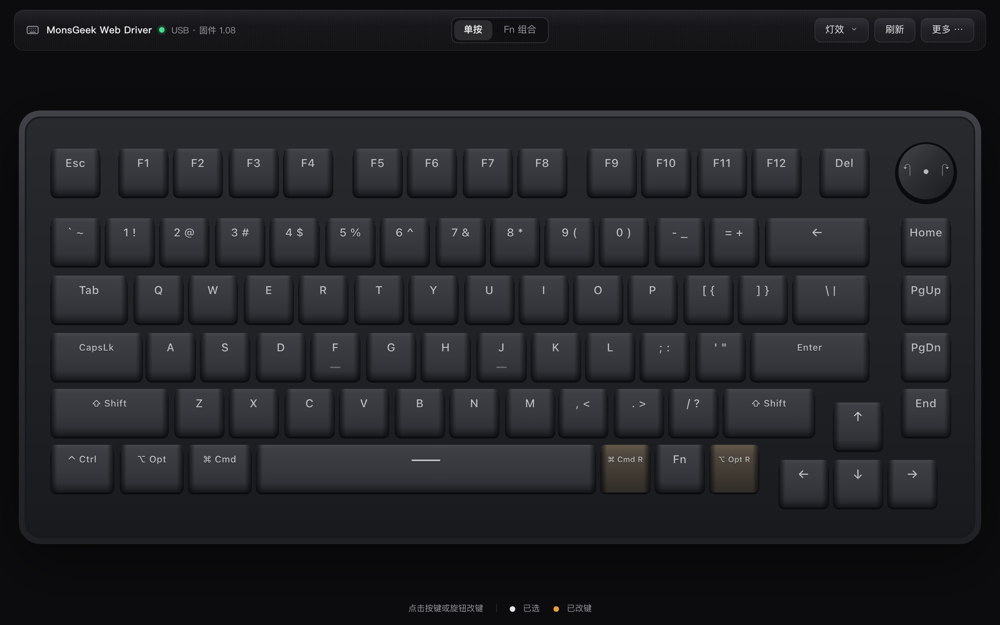

# MonsGeek Web Driver

通过 WebHID 配置 MonsGeek M1W 键盘，无需安装驱动。

[打开网页](https://kuaner.github.io/monsgeek-webdriver/) · [协议笔记](docs/protocol-notes.md)



## 支持的设备

- RongYuan（皇元）M1W RGB，USB `3151:4015`，固件 1.04 / 1.08。
- 使用 Chrome 或 Edge，通过 USB 数据线连接并切换到有线模式。
- HFD M1W VIA（USB `3555:3670`）使用 [VIA](https://usevia.app/) 配置。

## 功能

- 设置单按和 Fn 组合；修改 Fn 组合时，单按功能保持不变。
- 录制宏并调整按键事件、延时和播放方式。
- 设置旋钮动作、灯效、亮度、速度和颜色。
- 手动保存、切换、导入或导出配置，也可以恢复默认设置。
- 按键和灯效写入后会读回校验；校验失败时尝试恢复原值。


## 使用

1. 打开网页，将键盘连接到电脑并切换到有线模式。
2. 点击「连接键盘」，选择 MonsGeek Keyboard 并授权。
3. 选择「单按」或「Fn 组合」，点击键盘图上的按键进行设置；旋钮和灯效也可以在页面中设置。

网页可通过浏览器安装为 PWA，更新时会显示提示。不同网址的设备授权和本地保存的配置相互独立。

## 固件

M1W 设备 983 的原厂 1.08 固件及 macOS 升级脚本见[固件说明](firmware/m1w-983/README.md)。

## 注意事项

- 固件 1.08 的 Fn 单键写入和宏绑定已在真机上读回验证；Fn 组合的物理触发和宏播放尚未验证。固件 1.04 的 Fn 层暂时只读。
- 宏录制仅支持浏览器收到的键盘事件，系统保留快捷键和 Fn 本身可能无法录制。
- 如果 macOS Chrome 的 WebHID 连接卡住，可点击「连接键盘」重新授权。建议同时只打开一个页面。

## 开发

```sh
npm ci
npm run dev       # http://127.0.0.1:8765
npm run check     # Svelte / TypeScript 检查
npm test
npm run build
```

推送 `v*` 标签会运行检查、部署 GitHub Pages 并创建 Release。
