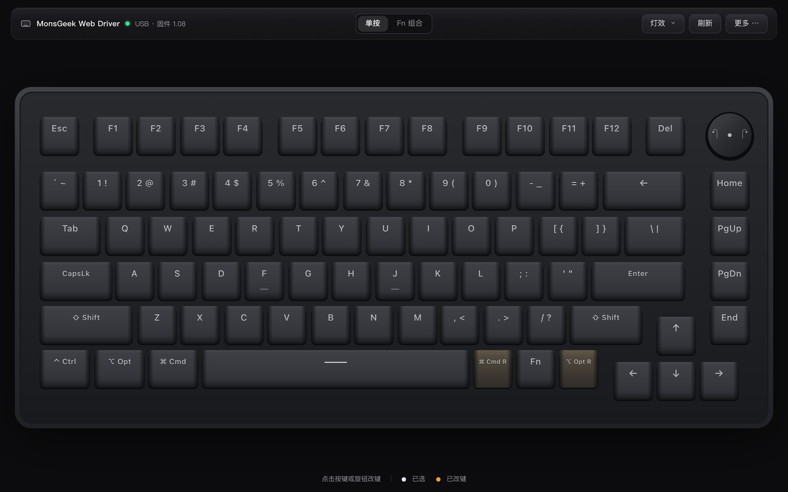

# MonsGeek Web Driver

MonsGeek M1W 和 M7W 的网页配置工具。通过浏览器连接键盘，无需安装原厂驱动或后台服务。

[打开网页](https://kuaner.github.io/monsgeek-webdriver/) · [协议说明](docs/protocol-notes.md)



## 支持设备

RongYuan M1W RGB，设备 ID 983：

| 连接方式 | 设备 |
| --- | --- |
| 有线 USB | `3151:4015` |
| 2.4G 接收器 | `3151:4011`，显示键盘电量 |
| 蓝牙 | `3151:4013` |

RongYuan M7W RGB，设备 ID 1215 / 固件 1.00：蓝牙 `3151:4013` 已实测支持基础层改键、灯效亮度与 Fn 层读取；有线 USB 已实测识别及基础层、Fn 层读取。Fn 层暂时只读，宏写入尚未验证，已禁用。M7W 的 2.4G 尚未真机测试。

需要支持 WebHID 的 Chrome 或 Edge。M1W 固件 1.04 支持基础层配置，固件 1.08 同时支持 Fn 层配置。应用通过设备 ID 自动选择相应布局；不同型号的配置不会互相导入到键盘。

HFD M1W VIA（`3555:3670`）是另一款硬件，请使用 [VIA](https://usevia.app/)。

## 功能

- SVG 键盘布局。M1W 键帽跟随键盘模式；M7W 按官方布局显示实体键名，不推断拨杆对输出的影响。
- 单按改键、组合键；已验证的设备支持独立 Fn 层设置和宏编辑。
- 带旋钮的型号支持逆时针、按下和顺时针三个独立动作。
- 灯效、亮度、速度、彩虹和自定义颜色。
- 手动保存、切换、导入、导出配置及恢复默认。
- 写入后读回校验，失败时恢复原值。


## 使用

1. 打开网页，点击 USB、2.4G 或蓝牙。
2. 在浏览器设备列表中选择键盘或接收器并授权。
3. 点击按键、旋钮或「灯效」进行设置。
4. 配置管理、导入导出和恢复默认位于「更多」菜单。

2.4G 模式需要插入接收器，并将键盘切换到 2.4G。键盘休眠后，先按键唤醒再操作。

网页可以安装为 PWA。设备授权和手动保存的配置仅属于当前网址，不会上传。

## 固件

M1W 设备 983 的原厂 1.08 固件和 macOS 升级工具见[固件说明](firmware/m1w-983/README.md)。

## 开发

```sh
npm ci
npm run dev       # http://127.0.0.1:8765
npm run check     # Svelte / TypeScript 检查
npm test
npm run build
```

如果此地址以前运行过构建版 PWA，旧 Service Worker 可能继续提供旧网页。切换到开发服务器时，可在 Chrome 开发者工具的 Application → Service Workers 中，对 `127.0.0.1:8765` 选择 Unregister，再刷新；这不会清除保存的配置或设备授权。

推送 `v*` 标签会运行检查、部署 GitHub Pages 并创建 Release。
