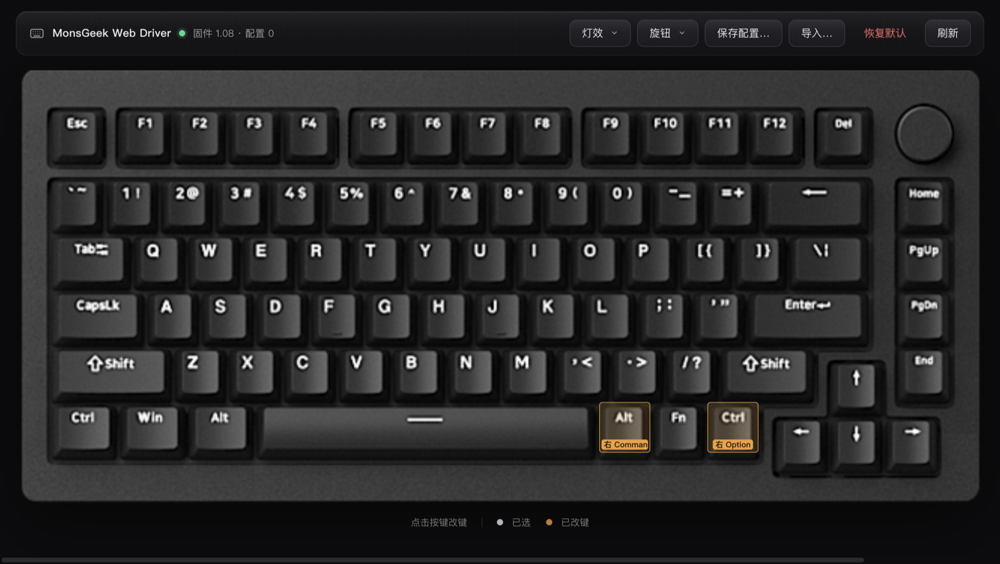
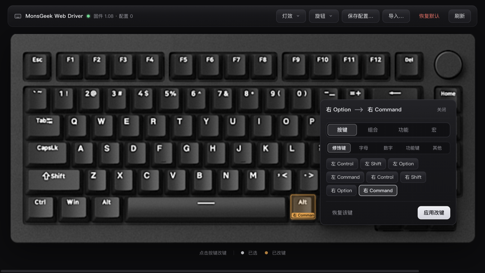
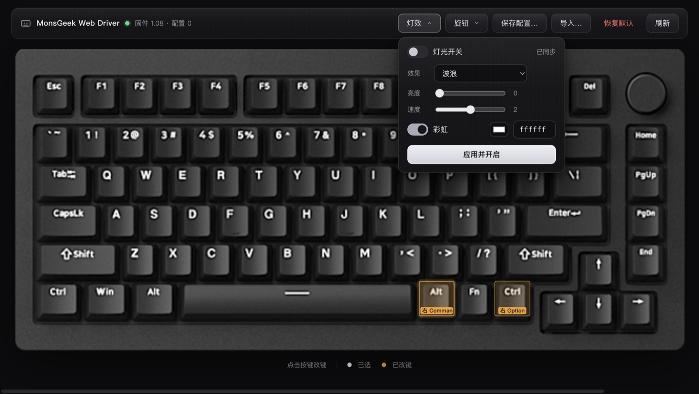

# MonsGeek Web Driver

> MonsGeek（RongYuan / 皇元平台）键盘的**浏览器端**配置工具——WebHID 直连，无需安装任何客户端。
> 改键 · 组合键 · 宏 · 灯效 · 配置方案，磨砂金属黑主题，可作为 PWA 安装。



## 支持的键盘

| 键盘 | 平台 | USB | 固件 | 状态 |
|---|---|---|---|---|
| **MonsGeek M1W RGB**（RongYuan yc500，三模 75%） | macOS / Windows | `3151:4015` | 1.04 / 1.08 | ✅ 已支持 |

说明：

- 需要 **Chrome / Edge** 等 Chromium 系浏览器（WebHID），键盘通过 **USB 有线**连接（蓝牙 / 2.4G 下配置协议不可用）。
- HFD 制造的 M1W VIA（QMK 固件，USB `3555:3670`）**不是**本工具的目标设备——那一支请使用 [VIA](https://usevia.app/)。两者只是同名，硬件平台完全不同。
- 未验证的设备/固件会以**只读**模式连接，不会写入。

## 功能



- **改键**：点击键盘图上的任意键（82 键 + 旋钮 3 动作），在弹出的面板中改键。支持单键（修饰键/字母/数字/功能键分组页签）、组合键（⌘⌃⌥⇧ 修饰，最多 3 键）、功能（媒体 / 灯光快捷键 / 禁用）与宏。已修改的键在键盘图上有琥珀色标记。
- **写后读回校验**：每次写入都读回验证，失败自动还原原值并明确报告——不会把键盘改坏。
- **宏**：50 槽 × 256B，键盘事件编辑（按下/松开/延时）、播放方式（指定次数 / 再按停止 / 按住重复）。



- **灯效**：20 种模式、亮度 / 速度、彩虹与自定义色（纯白按厂商规则编码，不会写成灰白）。
- **配置方案**：手动保存 / 切换 / 导出 / 导入（JSON 与原生客户端互通），日常操作绝不自动备份。
- **恢复默认**：显式二次确认后才执行。

## 使用

1. 用 Chrome / Edge 打开本工具，键盘插 USB 线并切到**有线模式**；
2. 点击「连接键盘」，在弹出的授权框选择 MonsGeek Keyboard（只需一次，之后自动重连）；
3. 点击键盘图上的按键开始改键，或从顶部菜单进入灯效 / 旋钮设置。

也可以把本工具**安装为应用**（PWA）：Chrome 地址栏右侧的安装图标，或菜单 →「安装 MonsGeek Web Driver」。已安装的副本会在发版后自动检测新版本并提示更新。

## 开发

```sh
cd web
npm install
npm run dev        # http://127.0.0.1:8765
npm test           # vitest：40 项协议测试（与原生 Swift 实现逐项对拍）
npm run build      # 产物 dist/，任意静态托管
```

发版：推送 `v*` tag 触发 GitHub Actions（`.github/workflows/deploy.yml`）——测试、构建、部署 GitHub Pages 并创建 Release。

## 架构

```
src/
  lib/protocol/     协议层（纯 TypeScript，node 可测）
    core.ts         帧构造、BIT7/BIT8 校验、灯效/宏编解码、设备信息、快照（schema 2）
    client.ts       查询/矩阵分块双读/改键/灯效/宏/配置切换（读回校验+失败还原）
    hid.ts          WebHID 传输（接口 2 厂商 Feature 集合 0xFFFF:0x0002；瞬时失败自愈）
    mock.ts         模拟键盘（测试）
  lib/state/        Svelte 5 runes 控制器（全局 USB 串行队列 + Web Locks 跨标签互斥）
  components/       键盘舞台 / 改键 popover / 顶部菜单 / 宏编辑 / 新版本提示
tests/protocol.test.ts
```

协议逆向与真机验证记录见 [`docs/protocol-notes.md`](docs/protocol-notes.md)（帧格式、校验、全部命令、线上实测细节）。

## 致谢与协议研究

本项目基于对 RongYuan 平台 M1W 私有协议的逆向研究，配套的原生 macOS 客户端（Swift 实现，配置文件与本工具互通）开发于同一研究过程，不在本仓库内。

## 已知限制

- macOS Chrome 偶发 WebHID 连接层卡死（键盘本身健康）：点一次「连接键盘」重新授权即可恢复。
- 多标签页同时打开会争用设备（已用 Web Locks 互斥，仍建议只开一个）。
- Fn 层只读（可随配置保存 / 恢复，不支持直接编辑）；宏编辑仅支持键盘事件。
